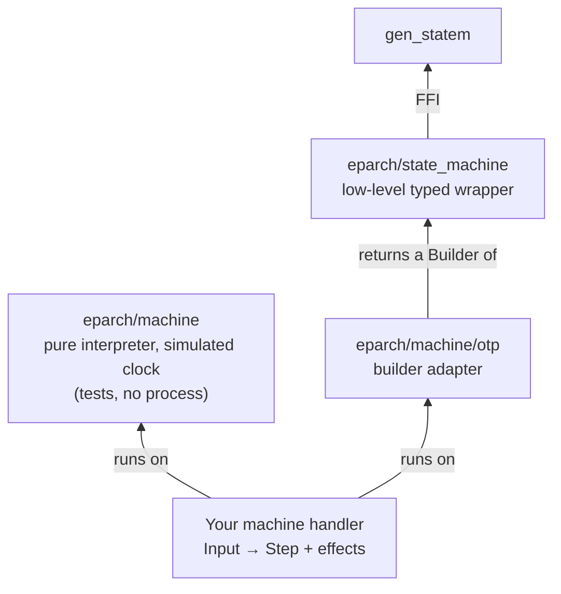

# Eparch

[](https://hex.pm/packages/eparch)
[](https://hexdocs.pm/eparch/)
[](https://www.erlang.org/)


[](https://builtwithnix.org)
[![[Nix] Build & Test](https://github.com/byzantine-systems/eparch/actions/workflows/build.yml/badge.svg)](https://github.com/byzantine-systems/eparch/actions/workflows/build.yml)

> **EPARCH OF THE CITY (ἔπαρχος τῆς πόλεως)**, successor of the late Roman URBAN PREFECT, the governor of Constantinople. [^1]
>
> [^1]: The Oxford Dictionary of Byzantium, Vol II.

Eparch is a Gleam library that wraps certain Erlang/OTP behaviours with a type-safe API, making your [byzantine systems](https://en.wikipedia.org/wiki/Byzantine_fault) shine with a great type system.

## Supported OTP Behaviours

| Module | Built on | Purpose |
|---|---|---|
| `eparch/machine`, `eparch/machine/otp` | `eparch/state_machine` | **Recommended.** Write transition logic once as pure functions, test it without processes on a simulated clock, run it unchanged on `gen_statem` |
| `eparch/state_machine` | [`gen_statem`](https://www.erlang.org/doc/apps/stdlib/gen_statem.html) | **Low-level.** A typed, thin wrapper exposing all of `gen_statem`, to build on however you want |
| `eparch/event_manager` | Gleam OTP actors | Broadcast to independently scheduled handlers |

Full API reference: <https://hexdocs.pm/eparch>.

### Which state machine module?

There is one engine, `gen_statem`, and two ways to write for it:



- Start with `eparch/machine`. Its handlers return `effect` values instead of performing them, so the same function runs in a unit test and in production.
- Drop down to `eparch/state_machine` for what `machine` does not cover: `cast`/`call` from clients, request-id collections, `format_status`, callback modules, debug and spawn options, or your own abstraction on top of `gen_statem`. `machine/otp.builder` returns a `state_machine.Builder`, so both levels mix: build with `machine`, then start, name and call through `state_machine`.

> **Looking for session types?** The experimental session-types layer (the protocol grammar, duality witnesses, the specification/projection/codegen toolchain and the `gen_statem` protocol driver) now lives in [`pacta`](https://github.com/byzantine-systems/pacta), which depends on this package. Eparch is the OTP wrapper, and nothing more.

### Key Differences from `gen_statem`

| Erlang's `gen_statem` | `eparch/state_machine` |
|---|---|
| Event type and payload passed separately | Single handler dispatching on a unified `Event` type |
| Raw action tuples | Type-safe `Action` values |
| Optional `state_enter` callback mode | Opt-in via `with_state_enter()` |
| Multiple return tuple formats | Single `Step` type (`NextState`, `KeepState`, `Stop`) |

### Testing transitions without processes

A `machine` handler returns `effect` values (reply, postpone, arm a timer) instead of performing them. `eparch/machine` interprets it as a plain value driven by `step` and a simulated clock, while `eparch/machine/otp` runs the same handler on `gen_statem`. A differential test keeps the two in agreement.

```gleam
import eparch/effect
import eparch/machine
import eparch/machine/otp
import eparch/state_machine
import gleam/option

pub type Door {
  Locked
  Open
}

pub type Msg {
  Unlock
  AutoLock
}

// Written once, used by both interpreters.
pub fn handle(
  input: machine.Input(Msg, Nil),
  door: Door,
  data: Nil,
) -> machine.Step(Door, Nil, Msg, Nil) {
  case input, door {
    machine.Cast(Unlock), Locked ->
      machine.NextState(Open, data, [
        effect.StateTimeout(effect.After(5000), AutoLock),
      ])
    machine.Timeout(effect.StateTimer, AutoLock), Open ->
      machine.NextState(Locked, data, [])
    _, _ -> machine.KeepStateAndData([])
  }
}

pub fn door_test() {
  // In a test: no process, no sleeping.
  let door = machine.new(phase: Locked, data: Nil, handler: handle)
  let #(_, door) = machine.step(door, machine.Cast(Unlock))
  assert machine.phase(door) == Open
  let #(_, door) = machine.advance_time(door, 5000)
  assert machine.phase(door) == Locked
}

pub fn start_door() {
  // In production: the same handler on gen_statem.
  otp.builder(phase: Locked, data: Nil, handler: handle, on_enter: option.None)
  |> state_machine.start_link
}
```

Relative `After` delays mean the same in both. An absolute `At` deadline does not carry over: the simulated clock starts at zero, while `gen_statem` reads `erlang:monotonic_time/1`.

## Installation

```sh
gleam add eparch
```

### Usage

See the [Quick Start guide](https://hexdocs.pm/eparch/docs/quick_start.html) for full walkthroughs, or run some of the example projects that live in the [`examples/`](https://hexdocs.pm/eparch/examples/readme.html) directory.

## Development

The project uses [devenv](https://devenv.sh/) and [Nix](https://nixos.org/) for a hermetic development environment:

```sh
nix develop
```

Or, if you are already using [direnv](https://direnv.net/):

```sh
direnv allow .
```

The Erlang implementation is also a standalone rebar3 library under `src/eparch/ffi`. Gleam compiles the nested Erlang sources directly when it builds or publishes `eparch`, while these commands check the Erlang project on its own:

```sh
# Compile, run EUnit, and then Dialyzer
make ffi-check

# Regenerate src/eparch/ffi/deps.nix with rebar3_nix
make ffi-deps-nix
nix build .#eparch-ffi
```
